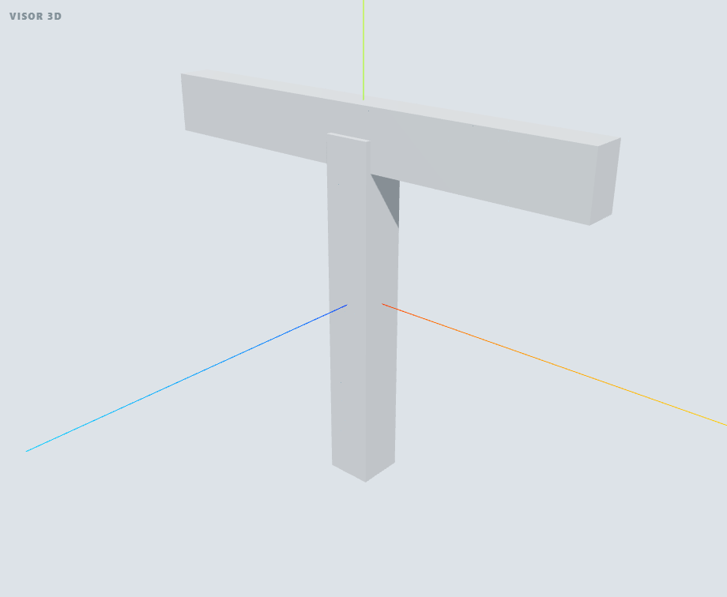
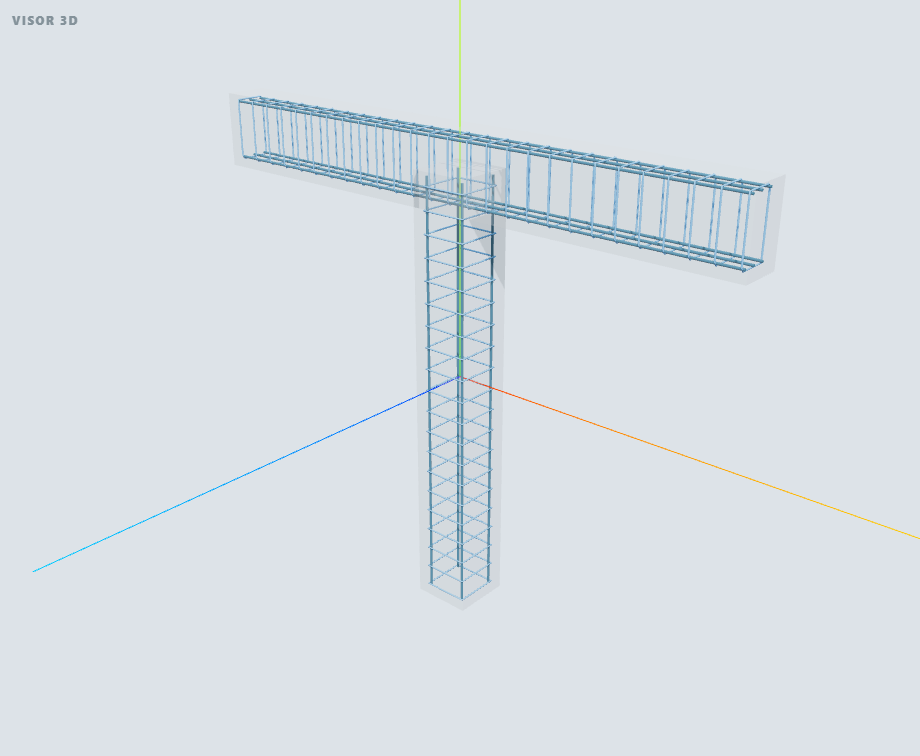
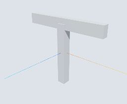
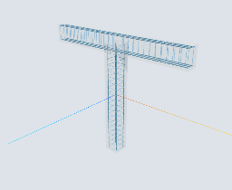

# Informe de captura WebGL con Spector.js

Se capturó un fotograma en **Sólido** y otro en **X-Ray al 35 %**. Spector.js registró **120 llamadas de dibujo por fotograma**. En X-Ray, el concreto se mezcla con lo que ya se dibujó en pantalla y el acero conserva su opacidad.

## Condiciones de la comparación

Se usó Spector.js 0.9.30 en Microsoft Edge 157 sin interfaz, con WebGL 2 y SwiftShader. La ventana fue de 1440 × 900 píxeles y el canvas de 920 × 756. Ambas capturas usan la unión inicial, iluminación Estudio, sin selección, sin despiece y con todas las piezas visibles. La cámara se mantuvo en `(4.32, 2.88, 4.92)`, mirando al origen. El [resumen JSON](evidence/spector-informe/resumen.json) registra los valores de cada ejecución.

## Capturas

### Sólido



El concreto de la viga y la columna cubre las barras y los estribos interiores. WebGL sigue dibujando esas mallas. La prueba de profundidad determina qué fragmentos quedan visibles.

### X-Ray al 35 %



La envolvente de concreto deja ver las barras longitudinales y los estribos. La proyección, la geometría y la posición de la cámara son las mismas que en Sólido.

### Imágenes guardadas dentro de las trazas de Spector.js

| Sólido | X-Ray |
|---|---|
|  |  |

Estas dos miniaturas de 256 × 210 píxeles se extrajeron del adjunto `Canvas COLOR_ATTACHMENT` de `endState.VisualState`. Las imágenes grandes de arriba son capturas del canvas tomadas con Playwright a la resolución del visor. Las trazas completas se conservan en [Sólido](evidence/spector-informe/solido.json.gz) y [X-Ray](evidence/spector-informe/xray.json.gz).

## Llamadas de dibujo y pasadas

| Métrica de Spector.js | Sólido | X-Ray |
|---|---:|---:|
| `CommandsSummary.draw` | 120 | 120 |
| `drawElements` | 118 | 118 |
| `drawArrays` | 2 | 2 |
| Dibujos en el framebuffer de sombras | 59 | 59 |
| Dibujos en el framebuffer de pantalla | 61 | 61 |
| Triángulos registrados en ambas pasadas | 147 408 | 147 408 |

La pasada de sombras dibuja las 59 mallas en un framebuffer de 2048 × 2048. La pasada de pantalla dibuja esas 59 mallas y añade dos llamadas de líneas para la cuadrícula y los ejes. Esa repetición explica las 118 llamadas indexadas. Los 59 objetos que indica el visor son las mallas de la unión. Los 120 dibujos contabilizan su participación en las dos pasadas y los ayudantes de la escena.

Las llamadas emplean `drawElements` o `drawArrays`. En los fotogramas observados no aparecen variantes instanciadas y los atributos del concreto tienen divisor cero. El número de dibujos se mantiene al cambiar de modo. La captura permite comparar comandos y estados de WebGL. El rendimiento requeriría una medición específica de tiempos.

## Inspección de `V-01-concrete`

Busca el marcador `V-01-concrete` y elige su comando con `DrawCall.frameBuffer === null` para inspeccionar la pasada de pantalla. En estas trazas corresponde al comando **207 en Sólido** y **459 en X-Ray**. Ambos ejecutan la misma llamada.

```text
drawElements(TRIANGLES, 36, UNSIGNED_SHORT, 0)
```

- `TRIANGLES` agrupa cada tres índices en un triángulo. Los 36 índices representan 12 triángulos, dos por cara del volumen rectangular de la viga.
- `UNSIGNED_SHORT` indica 16 bits por índice. Los 36 índices ocupan 72 bytes en `ELEMENT_ARRAY_BUFFER`. El último argumento indica que la lectura comienza en el byte 0.
- `position` está en la ubicación 0 y `normal` en la 1. Cada atributo tiene tres componentes `FLOAT`, de 4 bytes cada uno, con un stride de 12 bytes y offset 0. Cada buffer ocupa 288 bytes, correspondientes a 24 registros. Las caras pueden usar distintas normales en una misma esquina física.

### Shaders y transformaciones

La fuente GLSL ES 3.00 que WebGL recibió está en `DrawCall.shaders[].source`, con un registro `VERTEX_SHADER` y otro `FRAGMENT_SHADER`. El bloque muestra las instrucciones capturadas para la normal, la posición y el color de salida.

```glsl
// Vértices
vNormal = normalize( transformedNormal );
gl_Position = projectionMatrix * mvPosition;

// Fragmentos
vec4 diffuseColor = vec4( diffuse, opacity );
gl_FragColor = vec4( outgoingLight, diffuseColor.a );
```

El shader de vértices transforma cada vértice a coordenadas de recorte y prepara la normal para la iluminación. El shader de fragmentos calcula la luz de salida y usa el canal alfa del color difuso para el resultado. Los valores de los uniforms de esa llamada se guardan en `DrawCall.uniforms`:

| Uniform | Papel y observación |
|---|---|
| `modelMatrix` | Lleva la pieza del espacio local al mundo. En la captura, la traslación de la viga está en Y = 1.375 unidades de escena. |
| `modelViewMatrix` | Combina la transformación de la pieza con la vista de la cámara. Produce la posición en el espacio de vista. |
| `projectionMatrix` | Aplica la proyección en perspectiva y produce la posición de recorte usada por el rasterizador. |
| `normalMatrix` | Transforma las normales a espacio de vista para el cálculo de iluminación. |
| `opacity` | Vale `1` en Sólido y `0.3499999940395355` en X-Ray. Ese último valor es la representación de 35 % en coma flotante de 32 bits. |

### Profundidad, mezcla y piezas de acero

| Estado de `V-01-concrete` | Sólido | X-Ray |
|---|---|---|
| `DEPTH_TEST` y `DEPTH_FUNC` | Activada, `LEQUAL` | Activada, `LEQUAL` |
| `DEPTH_WRITEMASK` | Activada | Desactivada |
| `BLEND` | Desactivado | Activado, `FUNC_ADD` para RGB |
| Factores RGB de mezcla | — | `SRC_ALPHA` y `ONE_MINUS_SRC_ALPHA` |

`LEQUAL` permite un fragmento cuando su profundidad es menor o igual a la almacenada. En X-Ray, el concreto conserva esa comprobación y deja intacto el buffer de profundidad. Para los fragmentos que pasan, la mezcla calcula aproximadamente `0.35 × RGB del concreto + 0.65 × RGB ya dibujado`. Los marcadores de la barra `V-01-top-1` y del estribo `V-01-stirrup-1` muestran opacidad `1`, escritura de profundidad y blending desactivado en los dos fotogramas.

## Reproducción

Inicia el visor con `npm run dev -- --host 127.0.0.1` y prepara el bundle según la [guía de Spector.js](spector-guide.md). El segundo argumento del script activa la salida con PNG y dirige las trazas a la carpeta del informe.

```powershell
node docs/capture-spector.mjs "$env:TEMP/package/dist/spector.bundle.js" docs/evidence/spector-informe
```

Para inspeccionar una traza, descomprime su archivo `.json.gz` e importa el JSON en el visor de resultados de Spector.js. Busca el marcador de la pieza en la lista de comandos y revisa `DrawCall`, `DepthState` y `BlendState` en el comando correspondiente. El [resumen](evidence/spector-informe/resumen.json) conserva los identificadores y los recuentos de esta ejecución.
